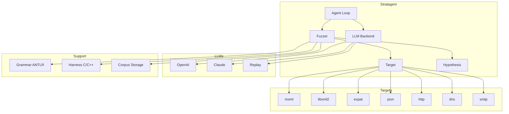
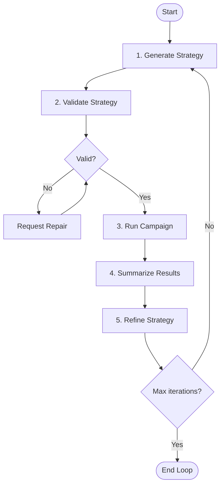
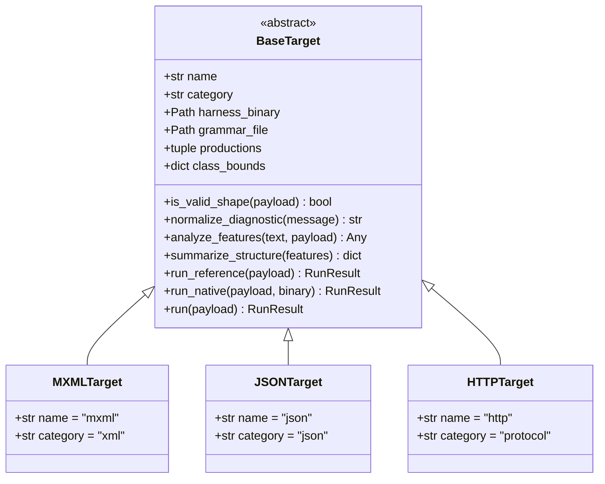
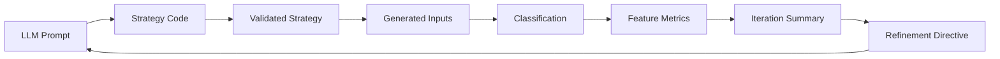
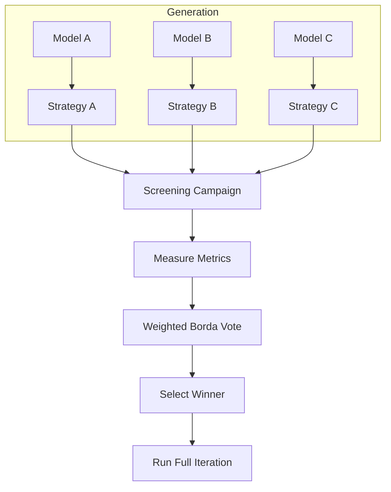
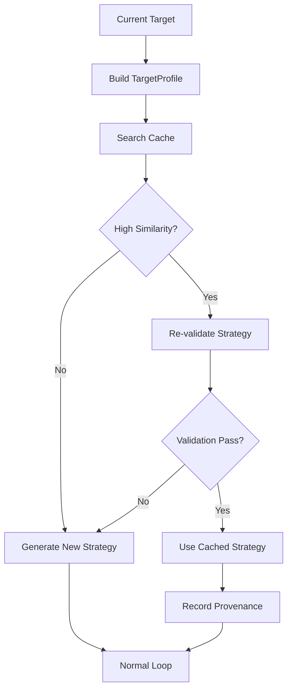
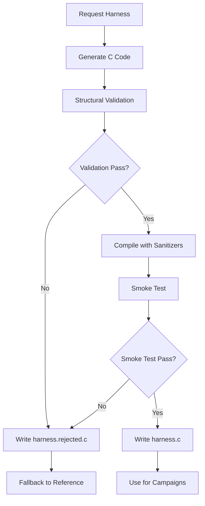

# Stratagem Architecture

This document provides architectural diagrams and explanations of the Stratagem agentic fuzzing framework.

## Table of Contents

- [High-Level Architecture](#high-level-architecture)
- [Agentic Loop Flow](#agentic-loop-flow)
- [Target Abstraction Layer](#target-abstraction-layer)
- [Component Interactions](#component-interactions)
- [Data Flow](#data-flow)
- [Ensemble Enhancement](#ensemble-enhancement)
- [Strategy Cache](#strategy-cache)
- [Harness Generation](#harness-generation)

## High-Level Architecture

```
┌─────────────────────────────────────────────────────────────────┐
│                         Stratagem Framework                      │
├─────────────────────────────────────────────────────────────────┤
│                                                                  │
│  ┌──────────────┐      ┌──────────────┐      ┌──────────────┐  │
│  │   Agent Loop │─────▶│  Fuzzer      │─────▶│    Target    │  │
│  │              │      │              │      │              │  │
│  │  • Generate  │      │  • Campaign  │      │  • mxml     │  │
│  │  • Validate  │      │  • Runner    │      │  • libxml2  │  │
│  │  • Refine    │      │  • Triage    │      │  • expat    │  │
│  └──────────────┘      └──────────────┘      │  • json     │  │
│         │                     │               │  • http     │  │
│         │                     │               │  • dns      │  │
│         ▼                     ▼               │  • smtp     │  │
│  ┌──────────────┐      ┌──────────────┐      └──────────────┘  │
│  │  LLM Backend │      │  Hypothesis  │                          │
│  │              │      │              │                          │
│  │  • OpenAI    │      │  • Strategy  │                          │
│  │  • Claude    │      │  • Generator │                          │
│  │  • Replay    │      │  • Shrinking  │                          │
│  └──────────────┘      └──────────────┘                          │
│                                                                  │
├─────────────────────────────────────────────────────────────────┤
│                      Supporting Components                        │
│  ┌──────────────┐  ┌──────────────┐  ┌──────────────┐           │
│  │   Grammar    │  │   Harness    │  │   Corpus     │           │
│  │   (ANTLR)    │  │   (C/C++)    │  │   Storage    │           │
│  └──────────────┘  └──────────────┘  └──────────────┘           │
└─────────────────────────────────────────────────────────────────┘
```

### Mermaid Diagram



## Agentic Loop Flow

The core agentic loop iteratively generates, tests, and refines fuzzing strategies.

```
┌─────────────────────────────────────────────────────────────────┐
│                     Agentic Loop Iteration                       │
└─────────────────────────────────────────────────────────────────┘

                          ┌─────────────┐
                          │   Start     │
                          └──────┬──────┘
                                 │
                                 ▼
                    ┌──────────────────────┐
                    │  1. Generate Strategy │
                    │  (LLM → Python code)  │
                    └──────────┬───────────┘
                               │
                               ▼
                    ┌──────────────────────┐
                    │  2. Validate Strategy │
                    │  • Syntax check       │
                    │  • Interface check    │
                    │  • Smoke test (50)    │
                    │  • Class bounds       │
                    └──────────┬───────────┘
                               │
                    ┌──────────┴──────────┐
                    │ Valid?               │
                    └──────────┬──────────┘
                               │
                    ┌──────────┴──────────┐
                    │ No                   │ Yes
                    ▼                      ▼
         ┌──────────────────┐    ┌──────────────────┐
         │ Request Repair   │    │  3. Run Campaign  │
         │ (if < repairs)   │    │  (500 inputs)    │
         └────────┬─────────┘    └────────┬─────────┘
                  │                       │
                  └───────────┬───────────┘
                              │
                              ▼
                   ┌──────────────────────┐
                   │  4. Summarize Results │
                   │  • Acceptance rate    │
                   │  • Diagnostic div.    │
                   │  • Feature coverage   │
                   │  • Input classes      │
                   └──────────┬───────────┘
                              │
                              ▼
                   ┌──────────────────────┐
                   │  5. Refine Strategy   │
                   │  (feedback → LLM)     │
                   └──────────┬───────────┘
                              │
                              ▼
                   ┌──────────────────────┐
                   │  Max iterations?      │
                   └──────────┬───────────┘
                              │
                   ┌──────────┴──────────┐
                   │ No                   │ Yes
                   ▼                      ▼
            ┌──────────────┐       ┌──────────────┐
            │  Repeat from │       │   End Loop   │
            │  Step 1      │       └──────────────┘
            └──────────────┘
```

### Mermaid Diagram



## Target Abstraction Layer

The target abstraction layer provides a uniform interface for fuzzing different parsers and protocols.

```
┌─────────────────────────────────────────────────────────────────┐
│                    BaseTarget Interface                          │
├─────────────────────────────────────────────────────────────────┤
│                                                                  │
│  ┌──────────────────────────────────────────────────────────┐  │
│  │  Abstract Methods (must implement)                        │  │
│  │                                                           │  │
│  │  • is_valid_shape(payload: bytes) -> bool                │  │
│  │  • normalize_diagnostic(message: str) -> str              │  │
│  │  • analyze_features(text: str, payload: bytes) -> Any     │  │
│  │  • summarize_structure(features: list) -> dict            │  │
│  │  • run_reference(payload: bytes) -> RunResult            │  │
│  └──────────────────────────────────────────────────────────┘  │
│                                                                  │
│  ┌──────────────────────────────────────────────────────────┐  │
│  │  Concrete Methods (provided by base)                       │  │
│  │                                                           │  │
│  │  • run_native(payload, binary, ...) -> RunResult         │  │
│  │  • run(payload, ...) -> RunResult                        │  │
│  │  • harness_for_sanitizer(sanitizer) -> Path               │  │
│  └──────────────────────────────────────────────────────────┘  │
│                                                                  │
└─────────────────────────────────────────────────────────────────┘
                              │
                              ▼
┌─────────────────────────────────────────────────────────────────┐
│                         Target Registry                          │
├─────────────────────────────────────────────────────────────────┤
│                                                                  │
│  ┌──────────────┐  ┌──────────────┐  ┌──────────────┐          │
│  │  MXMLTarget  │  │  JSONTarget  │  │ HTTPTarget   │          │
│  │              │  │              │  │              │          │
│  │  category:   │  │  category:   │  │  category:   │          │
│  │  "xml"       │  │  "json"      │  │  "protocol"  │          │
│  └──────────────┘  └──────────────┘  └──────────────┘          │
│                                                                  │
│  ┌──────────────┐  ┌──────────────┐  ┌──────────────┐          │
│  │  ExpatTarget │  │  DNSTarget   │  │ SMTPTarget   │          │
│  │              │  │              │  │              │          │
│  │  category:   │  │  category:   │  │  category:   │          │
│  │  "xml"       │  │  "protocol"  │  │  "protocol"  │          │
│  └──────────────┘  └──────────────┘  └──────────────┘          │
│                                                                  │
└─────────────────────────────────────────────────────────────────┘
```

### Mermaid Diagram



## Component Interactions

Detailed interaction between key components during a fuzzing campaign.

```
┌─────────────────────────────────────────────────────────────────┐
│                    Component Interactions                         │
└─────────────────────────────────────────────────────────────────┘

User Request
     │
     ▼
┌──────────────┐
│ agent.loop   │  Main entry point
└──────┬───────┘
       │
       ├──────────────────────────────────────────────────────┐
       │                                                      │
       ▼                                                      ▼
┌──────────────┐                                    ┌──────────────┐
│ agent.llm     │  Prompt management                 │ fuzzer.      │
│              │  • Load system/user prompts         │ campaign     │
│              │  • Call LLM backend                  │              │
│              │  • Store transcript                  │  • Execute   │
└──────┬───────┘  │                                    │  • Measure   │
       │          │                                    └──────┬───────┘
       │          │                                           │
       ▼          │                                           ▼
┌──────────────┐  │                                  ┌──────────────┐
│ agent.       │  │                                  │ fuzzer.      │
│ validate     │  Strategy validation                │ runner       │
│              │  • Syntax check                      │              │
│              │  • Interface check                   │  • Run       │
│              │  • Smoke test                        │  • Classify  │
└──────┬───────┘  │                                    └──────┬───────┘
       │          │                                           │
       │          │                                           ▼
       │          │                                  ┌──────────────┐
       │          │                                  │ fuzzer.      │
       │          │                                  │ targets.base │
       │          │                                  │              │
       │          │                                  │  • Execute   │
       │          │                                  │  • Normalize │
       └──────────┼──────────────────────────────────│  • Analyze   │
                  │                                  └──────┬───────┘
                  │                                         │
                  │                                         ▼
                  │                                  ┌──────────────┐
                  │                                  │ hypothesis   │
                  │                                  │              │
                  │                                  │  • Generate  │
                  │                                  │  • Shrink    │
                  └──────────────────────────────────│  • Draw      │
                                                             │
                                                             ▼
                                                    ┌──────────────┐
                                                    │ Native Binary │
                                                    │ (with         │
                                                    │  sanitizers)  │
                                                    └──────────────┘
```

### Mermaid Sequence Diagram

```mermaid
sequenceDiagram
    participant User
    participant Loop as agent.loop
    participant LLM as agent.llm
    participant Validate as agent.validate
    participant Campaign as fuzzer.campaign
    participant Runner as fuzzer.runner
    participant Target as fuzzer.targets
    participant Hypothesis as hypothesis
    participant Binary as Native Binary

    User->>Loop: Run campaign
    Loop->>LLM: Generate strategy
    LLM->>LLM: Call backend API
    LLM-->>Loop: Return strategy code
    Loop->>Validate: Validate strategy
    Validate->>Hypothesis: Smoke test (50 inputs)
    Hypothesis-->>Validate: Results
    Validate-->>Loop: Validation result
    Loop->>Campaign: Run iteration
    Campaign->>Runner: Execute batch (500 inputs)
    Runner->>Hypothesis: Generate inputs
    Hypothesis-->>Runner: Input batch
    Runner->>Target: Run each input
    Target->>Binary: Execute harness
    Binary-->>Target: Result
    Target-->>Runner: RunResult
    Runner-->>Campaign: Results batch
    Campaign->>Target: Analyze features
    Target-->>Campaign: Feature data
    Campaign-->>Loop: Summary
    Loop->>LLM: Refine with feedback
    LLM-->>Loop: Next strategy
```

## Data Flow

How data flows through the system from generation to analysis.

```
┌─────────────────────────────────────────────────────────────────┐
│                          Data Flow                               │
└─────────────────────────────────────────────────────────────────┘

Strategy Generation
     │
     │ LLM Prompt (system + user + examples)
     ▼
┌──────────────────────┐
│  Strategy Code       │
│  (Python string)     │
└──────────┬───────────┘
           │
           │ Validation
           ▼
┌──────────────────────┐
│  Validated Strategy  │
│  (Python module)     │
└──────────┬───────────┘
           │
           │ Hypothesis execution
           ▼
┌──────────────────────┐
│  Generated Inputs    │
│  (500 documents)     │
└──────────┬───────────┘
           │
           │ Harness execution
           ▼
┌──────────────────────┐
│  Classification      │
│  (well_formed,       │
│   near_miss,         │
│   byte_hostile)      │
└──────────┬───────────┘
           │
           │ Feature extraction
           ▼
┌──────────────────────┐
│  Feature Metrics     │
│  (depth, diversity,  │
│   coverage)          │
└──────────┬───────────┘
           │
           │ Summary aggregation
           ▼
┌──────────────────────┐
│  Iteration Summary   │
│  (JSON)              │
└──────────┬───────────┘
           │
           │ Feedback to LLM
           ▼
┌──────────────────────┐
│  Refinement Directive │
└──────────┬───────────┘
           │
           └──────┐
                  │ Repeat
```

### Mermaid Diagram



## Ensemble Enhancement

The ensemble enhancement allows multiple models to propose strategies, which are then ranked by measurement.

```
┌─────────────────────────────────────────────────────────────────┐
│                    Ensemble Enhancement                          │
└─────────────────────────────────────────────────────────────────┘

┌─────────────────────────────────────────────────────────────────┐
│  Step 1: Multi-Model Generation                                  │
├─────────────────────────────────────────────────────────────────┤
│                                                                  │
│  ┌──────────────┐  ┌──────────────┐  ┌──────────────┐          │
│  │   Model A    │  │   Model B    │  │   Model C    │          │
│  │              │  │              │  │              │          │
│  │  LLM Call 1  │  │  LLM Call 2  │  │  LLM Call 3  │          │
│  └──────┬───────┘  └──────┬───────┘  └──────┬───────┘          │
│         │                 │                 │                   │
│         ▼                 ▼                 ▼                   │
│  ┌──────────────┐  ┌──────────────┐  ┌──────────────┐          │
│  │ Strategy A   │  │ Strategy B   │  │ Strategy C   │          │
│  └──────────────┘  └──────────────┘  └──────────────┘          │
│                                                                  │
└─────────────────────────────────────────────────────────────────┘
                              │
                              ▼
┌─────────────────────────────────────────────────────────────────┐
│  Step 2: Screening Campaign                                      │
├─────────────────────────────────────────────────────────────────┤
│                                                                  │
│  Run each candidate on small batch (e.g., 80 examples)          │
│  Measure: crashes, coverage, diagnostics, acceptance, depth      │
│                                                                  │
└─────────────────────────────────────────────────────────────────┘
                              │
                              ▼
┌─────────────────────────────────────────────────────────────────┐
│  Step 3: Weighted Borda Vote                                     │
├─────────────────────────────────────────────────────────────────┤
│                                                                  │
│  Criteria (with weights):                                        │
│  • Crashes: 10x weight (primary objective)                      │
│  • Coverage: 1x weight                                           │
│  • Diagnostics: 1x weight                                        │
│  • Acceptance fit: 1x weight                                     │
│  • Depth: 1x weight                                              │
│  • Throughput: 1x weight                                         │
│                                                                  │
│  Rank each candidate on each criterion, sum weighted scores      │
│                                                                  │
└─────────────────────────────────────────────────────────────────┘
                              │
                              ▼
┌─────────────────────────────────────────────────────────────────┐
│  Step 4: Winner Selection                                        │
├─────────────────────────────────────────────────────────────────┤
│                                                                  │
│  Highest-scoring strategy is selected for full iteration        │
│  Winner is run at full budget (e.g., 500 examples)             │
│                                                                  │
└─────────────────────────────────────────────────────────────────┘
```

### Mermaid Diagram



## Strategy Cache

The strategy cache enables reuse of validated strategies across similar targets.

```
┌─────────────────────────────────────────────────────────────────┐
│                    Strategy Cache                                │
└─────────────────────────────────────────────────────────────────┘

┌─────────────────────────────────────────────────────────────────┐
│  Step 1: Profile Similarity                                      │
├─────────────────────────────────────────────────────────────────┤
│                                                                  │
│  TargetProfile combines:                                         │
│  • Target name                                                   │
│  • Category (xml/json/protocol)                                 │
│  • Grammar hash                                                  │
│  • Production overlap                                            │
│  • Class bounds                                                  │
│                                                                  │
│  Similarity score: 0.0 to 1.0                                    │
│  • Same XML parser: 0.80-1.00                                    │
│  • Different XML parser: 0.80-1.00                               │
│  • XML vs JSON: ~0.0                                             │
│                                                                  │
└─────────────────────────────────────────────────────────────────┘
                              │
                              ▼
┌─────────────────────────────────────────────────────────────────┐
│  Step 2: Cache Lookup                                            │
├─────────────────────────────────────────────────────────────────┤
│                                                                  │
│  Search cache for strategies with high similarity scores        │
│  Ranked by similarity and historical performance                │
│                                                                  │
└─────────────────────────────────────────────────────────────────┘
                              │
                              ▼
┌─────────────────────────────────────────────────────────────────┐
│  Step 3: Re-validation                                            │
├─────────────────────────────────────────────────────────────────┤
│                                                                  │
│  Cache hit is not automatic acceptance:                          │
│  • Run full validation gates (syntax, interface, smoke test)     │
│  • Verify class bounds for current target                       │
│  • Only if validation passes, use cached strategy               │
│                                                                  │
└─────────────────────────────────────────────────────────────────┘
                              │
                              ▼
┌─────────────────────────────────────────────────────────────────┐
│  Step 4: Use or Fallback                                         │
├─────────────────────────────────────────────────────────────────┤
│                                                                  │
│  If validation passes:                                           │
│  • Use cached strategy (saves LLM call)                         │
│  • Record cache provenance in iteration output                  │
│                                                                  │
│  If validation fails:                                            │
│  • Fall back to LLM generation                                  │
│  • Proceed with normal agentic loop                             │
│                                                                  │
└─────────────────────────────────────────────────────────────────┘
```

### Mermaid Diagram



## Harness Generation

The harness generation feature creates target-specific C/C++ drivers automatically.

```
┌─────────────────────────────────────────────────────────────────┐
│                    Harness Generation                            │
└─────────────────────────────────────────────────────────────────┘

┌─────────────────────────────────────────────────────────────────┐
│  Step 1: Request Harness                                          │
├─────────────────────────────────────────────────────────────────┤
│                                                                  │
│  LLM receives target metadata:                                    │
│  • Target name and category                                      │
│  • Grammar productions                                           │
│  • Expected input format                                        │
│  • Required headers and link flags                               │
│                                                                  │
└─────────────────────────────────────────────────────────────────┘
                              │
                              ▼
┌─────────────────────────────────────────────────────────────────┐
│  Step 2: Generate Harness Code                                   │
├─────────────────────────────────────────────────────────────────┤
│                                                                  │
│  LLM writes C harness with:                                     │
│  • main() function                                               │
│  • stdin reading                                                 │
│  • DIAG\t output format for diagnostics                          │
│  • Exit codes: 0, 1, 2, 3                                        │
│  • Required headers                                              │
│  • Parser API calls                                              │
│                                                                  │
└─────────────────────────────────────────────────────────────────┘
                              │
                              ▼
┌─────────────────────────────────────────────────────────────────┐
│  Step 3: Structural Validation                                   │
├─────────────────────────────────────────────────────────────────┤
│                                                                  │
│  Automatic checks before accepting:                              │
│  • main() function present                                       │
│  • stdin reading code present                                    │
│  • DIAG\t output format used                                     │
│  • All four exit codes (0, 1, 2, 3) used                         │
│  • Required headers included                                     │
│  • Balanced delimiters (braces, parentheses)                     │
│  • No shell/process/socket calls (security)                      │
│                                                                  │
└─────────────────────────────────────────────────────────────────┘
                              │
                              ▼
┌─────────────────────────────────────────────────────────────────┐
│  Step 4: Compilation with Sanitizers                            │
├─────────────────────────────────────────────────────────────────┤
│                                                                  │
│  Compile with:                                                   │
│  • ASan (AddressSanitizer)                                       │
│  • UBSan (UndefinedBehaviorSanitizer)                            │
│  • Same flags as hand-written harnesses                          │
│                                                                  │
└─────────────────────────────────────────────────────────────────┘
                              │
                              ▼
┌─────────────────────────────────────────────────────────────────┐
│  Step 5: Smoke Test                                              │
├─────────────────────────────────────────────────────────────────┤
│                                                                  │
│  Test harness with:                                              │
│  • Valid input (should exit 0)                                  │
│  • Invalid input (should exit 1 or 3)                           │
│  • Known crash input (if available)                              │
│                                                                  │
└─────────────────────────────────────────────────────────────────┘
                              │
                              ▼
┌─────────────────────────────────────────────────────────────────┐
│  Step 6: Accept or Reject                                        │
├─────────────────────────────────────────────────────────────────┤
│                                                                  │
│  If all checks pass:                                             │
│  • Write to harness.c                                           │
│  • Use for fuzzing campaigns                                    │
│                                                                  │
│  If any check fails:                                             │
│  • Write to harness.rejected.c                                  │
│  • Fall back to reference runner or manual harness              │
│                                                                  │
└─────────────────────────────────────────────────────────────────┘
```

### Mermaid Diagram



## File System Layout

```
stratagem/
├── agent/                 # Agentic loop and LLM backends
│   ├── loop.py           # Main iteration logic
│   ├── llm.py            # LLM backend implementations
│   ├── validate.py       # Strategy validation
│   ├── ensemble.py       # Multi-model voting
│   ├── strategy_cache.py # Cross-target reuse
│   ├── tuning.py         # Automatic hyperparameter tuning
│   ├── fewshot.py        # Past strategy examples
│   ├── harness_gen.py    # Harness generation
│   ├── errors.py         # Error handling
│   ├── debug.py          # Debug CLI
│   ├── progress.py       # Progress bars
│   └── prompts/          # Prompt templates (v1-v5)
│
├── fuzzer/               # Fuzzing engine
│   ├── campaign.py       # Run strategies through harness
│   ├── runner.py         # Execute harness and classify
│   ├── features.py       # Analyze generated documents
│   ├── triage.py         # Crash deduplication
│   ├── grammar.py        # Grammar parsing
│   ├── corpus.py         # Corpus management
│   ├── minimize.py       # Input minimization
│   ├── strategies/       # Generated strategy modules
│   └── targets/          # Target implementations
│       ├── base.py       # Target abstraction
│       ├── xml_*.py      # XML parser targets
│       ├── json_target.py
│       └── protocol_*.py # Protocol targets
│
├── grammar/              # ANTLR grammars
│   ├── XML.g4
│   ├── JSON.g4
│   ├── HTTP.g4
│   ├── DNS.txt
│   ├── SMTP.g4
│   └── ADAPTATIONS.md    # Grammar vs parser differences
│
├── harness/              # C/C++ harnesses
│   ├── harness.c         # mxml harness
│   ├── build.sh          # Build script
│   └── yaml/             # Target-specific harnesses
│
├── docs/                 # Documentation
│   ├── architecture.md   # This file
│   ├── design-decisions.md
│   ├── findings.md
│   ├── developer-experience.md
│   └── tutorial-adding-targets.md
│
├── runs/                 # Campaign outputs
│   ├── my-campaign/
│   │   ├── iterations/
│   │   │   ├── iter-0/
│   │   │   │   ├── strategy.py
│   │   │   │   ├── summary.json
│   │   │   │   └── results.jsonl
│   │   │   └── iter-1/
│   │   ├── transcript/
│   │   │   ├── call-1/
│   │   │   │   ├── system.md
│   │   │   │   ├── user.md
│   │   │   │   └── response.json
│   │   │   └── call-2/
│   │   └── final_summary.json
│
├── scripts/              # Utility scripts
│   ├── ci.py             # Local CI runner
│   └── verify_replay.sh  # Replay verification
│
├── .github/workflows/    # CI/CD
│   └── ci.yml
│
├── README.md
├── CONTRIBUTING.md
├── pyproject.toml
└── requirements.txt
```

## Key Design Principles

1. **Blackbox Operation**: The loop does not use code coverage; it relies only on input properties and parser results.

2. **Reproducibility**: All LLM interactions are recorded for replay without credentials. Campaigns save exact input bytes.

3. **Extensibility**: The target abstraction layer makes it easy to add new parsers and protocols.

4. **Safety**: Generated harnesses are gated before compilation; sanitizers detect memory errors.

5. **Performance**: Strategies use Hypothesis for efficient generation; campaigns batch inputs for throughput.

6. **Developer Experience**: Hermetic tests, actionable errors, progress bars, and debug tooling.
